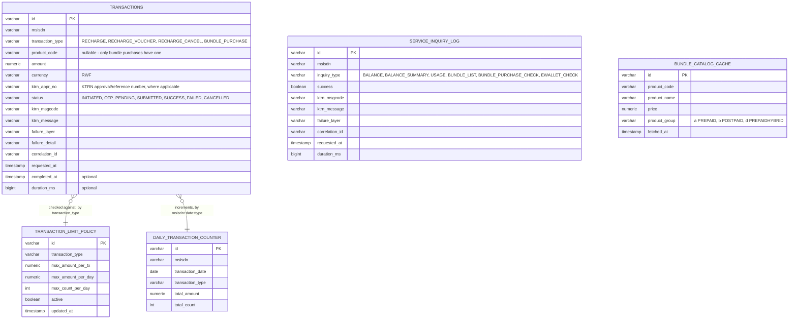
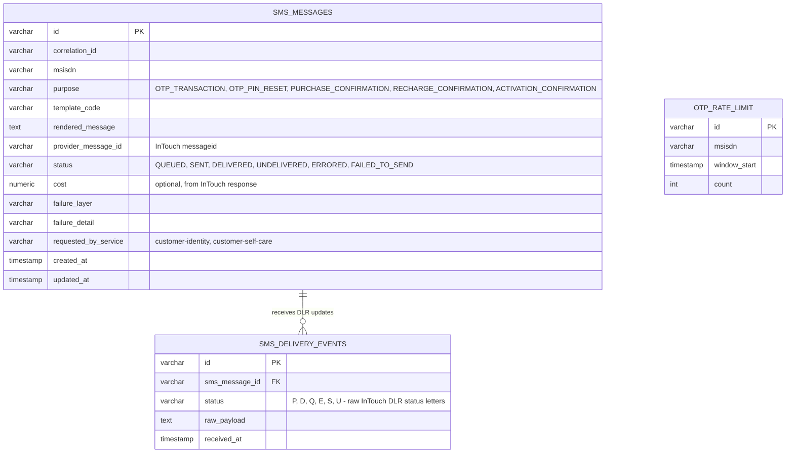
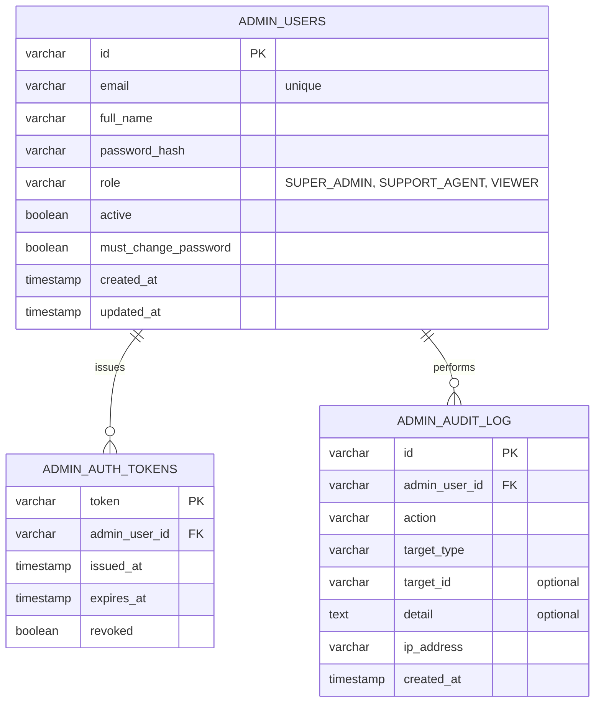

# Kopa Telecom — DB Diagram

One Postgres database, six schemas — but only **four have their own tables**:
`customer_identity`, `customer_self_care`, `notifications`, `admin_portal`. The two Middleware
services (`kopa.middleware-ktrn`, `kopa.middleware-sms`) are stateless and own no schema at all —
same convention as feature 2.1.1's Middleware, extended platform-wide.

Relationships drawn below are **real FKs only within a schema**. A reference to another service's
row (e.g. `transactions.msisdn` conceptually "belonging to" a `customer_identity.customers` row)
is a **plain column, no DB-level FK** — the owning service is the only writer; every other schema
that needs to read it defines its own **local read-only mirror entity**, exactly like DigiSanté's
`auth_access.accounts`/`auth_tokens` pattern. Cross-schema references are listed at the bottom of
each section, and read-only mirrors are listed separately in §5.

## Shared conventions used across every schema

- **`correlation_id`** (varchar) — on every table that records an attempt at something (a KTRN
  call, an SMS send, a transaction). Lets one request be traced across every service's logs and
  every DB row it touched. See `backend/architecture-reference.md` §9.
- **`failure_layer`** (varchar, one of `NONE, VALIDATION, MICROSERVICE, MIDDLEWARE, KTRN_GATEWAY,
  KTRN_BUSINESS, SMS_GATEWAY, SMS_BUSINESS, DATABASE`) + **`failure_detail`** (text) — populated
  whenever an attempt doesn't cleanly succeed, so a single row tells you *where* it broke.
- **`ktrn_msgcode`** / **`ktrn_message`** — the raw KTRN response header fields, passed through
  unmodified wherever a KTRN call was involved (see RBSS-CCBS API_ACCESS §1.1's Common Message
  table: `1001` success, `-4001..-7002` various failures).

---

## 1. `customer_identity`

```mermaid
erDiagram
    CUSTOMERS {
        varchar id PK
        varchar msisdn "unique, E.164-ish local format"
        varchar national_id "optional - NIDA"
        varchar passport_number "optional - DGIE, foreigners"
        varchar iccid
        varchar cust_id "KTRN CUST_ID, once subscribed"
        varchar cust_type "A Individual, B Self-Employee, C Foreigner, D Corporate, E Public Sector"
        varchar full_name
        date birth_day
        varchar email "optional"
        varchar address_detail
        varchar so_id "retailer code"
        varchar status "PENDING_ACTIVATION, ACTIVE, SUSPENDED, DEACTIVATED"
        timestamp created_at
        timestamp updated_at
    }
    CREDENTIALS {
        varchar customer_id PK_FK
        varchar pin_hash
        timestamp pin_set_at
        int failed_attempts
        timestamp locked_until "optional"
        boolean must_change_pin
    }
    AUTH_TOKENS {
        varchar token PK
        varchar customer_id FK
        timestamp issued_at
        timestamp expires_at
        boolean revoked
    }
    OTP_CHALLENGES {
        varchar id PK
        varchar customer_id FK
        varchar purpose "PIN_RESET, TRANSACTION_AUTH"
        varchar code_hash
        varchar msisdn
        int attempt_count
        timestamp expires_at
        timestamp consumed_at "optional"
        varchar correlation_id
        timestamp created_at
    }
    ACTIVATION_REQUESTS {
        varchar id PK
        varchar msisdn
        varchar iccid
        varchar product_code "selected price plan"
        varchar status "PENDING, PRICE_PLAN_FETCHED, KYC_VERIFIED, ACTIVATED, FAILED"
        varchar ktrn_msgcode
        varchar ktrn_message
        varchar failure_layer
        varchar failure_detail
        varchar correlation_id
        timestamp created_at
        timestamp updated_at
    }
    KYC_VERIFICATION_LOG {
        varchar id PK
        varchar activation_request_id FK
        varchar verification_type "NIDA, RRA, DGIE"
        varchar input_reference "national_id / TIN / passport_number, not the raw photo"
        varchar result_status
        varchar ktrn_msgcode
        varchar failure_layer
        varchar correlation_id
        timestamp created_at
    }

    CUSTOMERS ||--o| CREDENTIALS : "has"
    CUSTOMERS ||--o{ AUTH_TOKENS : "issues"
    CUSTOMERS ||--o{ OTP_CHALLENGES : "requests"
    ACTIVATION_REQUESTS ||--o{ KYC_VERIFICATION_LOG : "runs"
```

`customers` + `auth_tokens` are the equivalent of DigiSanté's `auth_access.accounts` — every
Mobile service that needs to resolve a bearer token mirrors these two tables read-only, same
mechanism as `architecture-reference.md` §8.3.

**Note on `KYC_VERIFICATION_LOG.input_reference`:** deliberately stores only a reference (the ID
number), never the raw NIDA photo / fingerprint payloads the KTRN calls carry — those are
biometric data and have no reason to persist locally once the verification call returns.

---

## 2. `customer_self_care`



**`TRANSACTIONS.product_code` is nullable by design** — a plain amount-based recharge has no
product code, a bundle purchase or voucher recharge does. This is the "every transaction is a
product [where applicable]" table: one unified row shape for every money-moving operation,
instead of a separate table per transaction type. `SERVICE_INQUIRY_LOG` is the read-only sibling
(no money moved) — the existing `balance_inquiry_log` from feature 2.1.1 generalizes into this
with an `inquiry_type` column once usage/bundle-browse endpoints are added.

**Constraint:** `DAILY_TRANSACTION_COUNTER` has a unique index on `(msisdn, transaction_date,
transaction_type)` — one row per subscriber per day per type, updated with an atomic
increment/upsert before a transaction is allowed to proceed to Middleware.

**Cross-schema reference (read-only mirror):** `customer_identity.customers` /
`.auth_tokens`, for token validation.

---

## 3. `notifications`



Same shape as `digi.sante.notifications.notification_log` — "no domain data of its own, it's a
send-log." `SMS_DELIVERY_EVENTS` is append-only because InTouch's DLR can arrive as a sequence of
intermediate statuses (`P` → `Q` → `S` → `D`/`U`), not a single terminal callback.

**Cross-schema reference (read-only mirror):** `customer_identity.customers` /
`.auth_tokens`, for token validation on `/internal/v1/**` callers where relevant.

---

## 4. `admin_portal`



Deliberately **not** connected to `customer_identity` at the schema level — Admin's identity is
entirely separate, per the Client/Admin separation requirement.

**Cross-schema references (read-only mirrors, reporting only, never written):**
`customer_identity.customers`, `customer_identity.activation_requests`,
`customer_self_care.transactions`, `customer_self_care.service_inquiry_log`,
`notifications.sms_messages`.

---

## 5. Read-only mirrors — summary table

| Mirroring service | Mirrors (read-only) | Why |
|---|---|---|
| `customer_self_care` | `customer_identity.{customers, auth_tokens}` | Bearer token validation |
| `notifications` | `customer_identity.{customers, auth_tokens}` | Bearer token validation on internal callers |
| `admin_portal` | `customer_identity.{customers, activation_requests}` | Customer/registration reporting |
| `admin_portal` | `customer_self_care.{transactions, service_inquiry_log}` | Transaction reporting, failure-layer dashboard |
| `admin_portal` | `notifications.sms_messages` | SMS delivery reporting |

Each mirror is a plain `@Entity` mapped with `schema = "<owning_schema>"`, mapping only the
columns the reading service actually needs, and is never the target of an `INSERT`/`UPDATE` from
outside its owning service — exactly DigiSanté's §5.2 pattern.

---

## 6. What's explicitly *not* modeled yet

- No `bundle_catalog` as a first-class managed table (only a `_cache` of KTRN's own list) — Kopa
  doesn't own the product catalog, KTRN does.
- No Mobile Money / card payment tables — out of scope per the Scope of Work §4.2, architecture
  leaves room for it later without a redesign (new `transaction_type` values, a new Middleware
  service for the payment gateway, same pattern as `kopa.middleware-sms`).
- No `admin_roles`/`permissions` table beyond the single `role` enum column — fine-grained
  permission strings (DigiSanté §6.6 style) can be added later if `SUPER_ADMIN` /
  `SUPPORT_AGENT` / `VIEWER` stops being granular enough.
